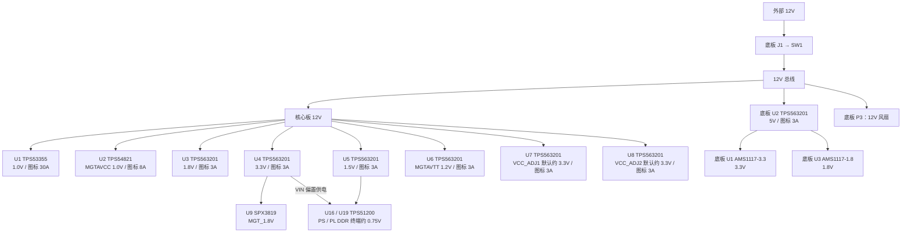
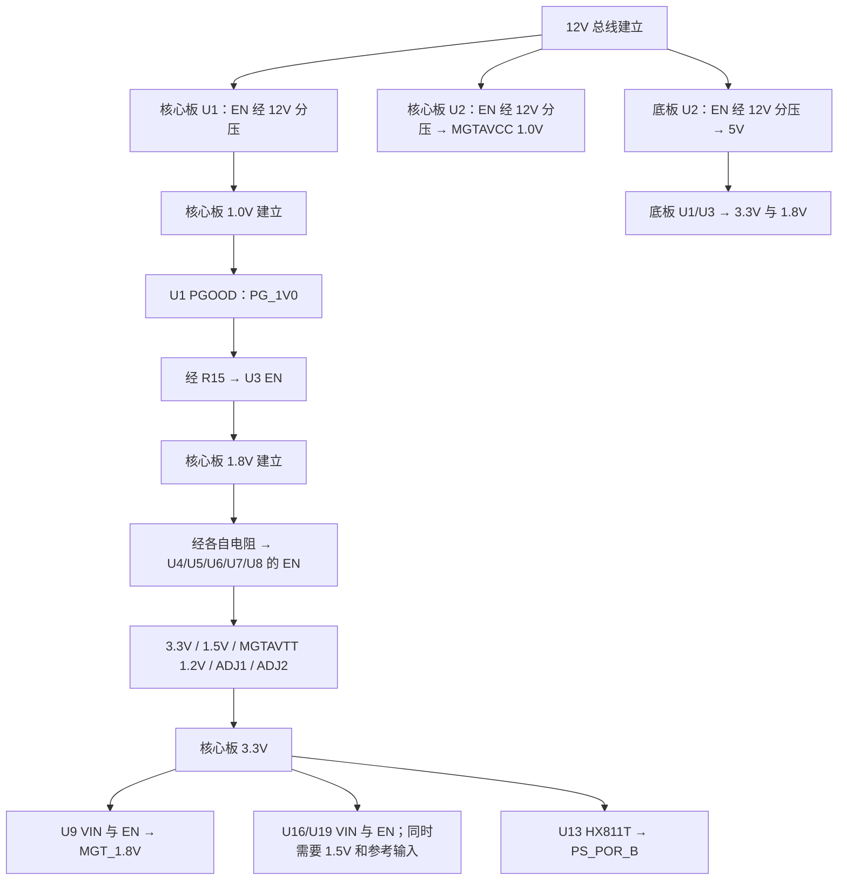

# OS-ZYNQ7100 开发板供电链路

依据 OS-ZYNQ7100 REV_A 核心板及 Dock Lite 底板原理图整理。

整板采用 **12V 输入，核心板与底板分别稳压**。核心板各路 DC/DC 的输入均为 12V；底板先将 12V 降为 5V，再通过两个 LDO 产生 3.3V 和 1.8V。

本文中的“核心板 U1”和“底板 U1”属于不同器件。两块板虽然使用相同的 `+3.3V`、`+1.8V` 网名，但从板间连接器接线看，这些低压电源分别在各自板上产生。电流数值仅沿用原理图标注，不代表实测负载电流或可供外设使用的余量。

## 1. 电源入口与跨板连接

| 环节 | 供电路径 | 图纸位置 |
|---|---|---|
| 外部电源入口 | 底板 J1 Type-C 的 VBUS → SW1 电源开关 → `+12V` 总线 | 底板第 2 页 |
| 核心板供电 | 底板 `+12V` → 板间连接器 → 核心板 `+12V` | 底板第 8、9 页；核心板第 14、15 页 |
| 底板电源 | 底板 `+12V` → U2 → 底板 `+5V` | 底板第 2 页 |
| 风扇 | 底板 `+12V` → P3，1 脚为 12V，2 脚为 GND | 底板第 7 页 |

12V 引出于底板 J5/J6/J7，以及核心板 J2/J3/J4；两块板通过连接器共地。

**两个 Type-C 接口的供电角色不同：**J1 是图中标注的 12V 电源入口；J2 是 USB 串口接口，其 VBUS 引脚标为未连接，CH340C 由底板 3.3V 供电。J1 的 CC 下拉电阻 R1/R2 标注为 `5.1K, NC`，图中未画出 USB PD 协商电路，因此这份原理图没有说明如何从普通 USB-C 电源取得 12V。

## 2. 电压转换总览

以下箭头表示电能供给和电压转换；上电使能关系见第 6 节。



## 3. 核心板各路稳压与负载

主要依据核心板第 2、9～13 页。

| 位号 / 芯片 | 电源输入 | 输出网名及标称电压 | 图纸电流标注 | 主要负载或去向 |
|---|---|---|---|---|
| U1 / TPS53355DQPR | 12V | `+1.0V`，1.0V | 30A | Zynq 的 VCCINT、VCCBRAM、VCCPINT |
| U2 / TPS54821RHLR | 12V | `MGTAVCC_1.0V`，1.0V | 8A | Zynq 高速收发器 MGTAVCC |
| U3 / TPS563201DDCT | 12V | `+1.8V`，1.8V | 3A | VCCAUX、VCCAUX_IO、VCCPAUX、VCCBATT；PL Bank35、PS Bank501；eMMC VCCQ；经磁珠供 VCCADC、VCCPLL |
| U4 / TPS563201DDCT | 12V | `+3.3V`，3.3V | 3A | PL Bank0/9、PS Bank500；两颗 QSPI Flash；eMMC VCC；时钟、复位及指示电路；U9 输入；U16/U19 的 VIN |
| U5 / TPS563201DDCT | 12V | `+1.5V`，1.5V | 3A | 四颗 DDR3 的 VDD/VDDQ；PL Bank33/34；PS DDR Bank502；U16/U19 的 VLDOIN 及参考分压 |
| U6 / TPS563201DDCT | 12V | `MGTAVTT_1.2V`，1.2V | 3A | Zynq 高速收发器 MGTAVTT |
| U7 / TPS563201DDCT | 12V | `VCC_ADJ1`，按图配置约 3.3V | 3A | `VCCIO_10`、`VCCIO_11` → PL Bank10/11 |
| U8 / TPS563201DDCT | 12V | `VCC_ADJ2`，按图配置约 3.3V | 3A | `VCCIO_12`、`VCCIO_13` → PL Bank12/13 |
| U9 / SPX3819M5-L-1-8 | 核心板 3.3V | `MGT_1.8V`，1.8V | 未标注 | Zynq 的 MGTVCCAUX |
| U16 / TPS51200 | VIN：3.3V；VLDOIN：1.5V | `PS_DDRVTT`、`PS_VTTREF`，约 0.75V | 未标注 | PS DDR 地址/控制线终端及 DDR 参考电压 |
| U19 / TPS51200 | VIN：3.3V；VLDOIN：1.5V | `PL_DDRVTT`、`PL_VTTREF`，约 0.75V | 未标注 | PL DDR 地址/控制线终端及 DDR 参考电压 |

### 3.1 可调 I/O 电源的图纸配置

U7 的反馈电阻为 R34 = 33.2kΩ、R36 = 10kΩ；U8 为 R35 = 33.2kΩ、R37 = 10kΩ。按图中公式：

```text
VOUT = 0.768 × (1 + R上 / R下)
     = 0.768 × (1 + 33.2 / 10)
     ≈ 3.318V
```

因此 `VCC_ADJ1` 和 `VCC_ADJ2` 在当前图纸配置下均按 3.3V 电源理解。“ADJ”表示输出由反馈电阻设定，图中没有软件调压控制电路。

### 3.2 Zynq I/O Bank 电压对照

| Bank | 电压 | 来源 |
|---|---|---|
| PL Bank0、Bank9 | 3.3V | 核心板 U4 |
| PL Bank10、Bank11 | 默认约 3.3V | 核心板 U7，VCC_ADJ1 |
| PL Bank12、Bank13 | 默认约 3.3V | 核心板 U8，VCC_ADJ2 |
| PL Bank33、Bank34 | 1.5V | 核心板 U5 |
| PL Bank35 | 1.8V | 核心板 U3 |
| PS Bank500 / MIO0 | 3.3V | 核心板 U4 |
| PS Bank501 / MIO1 | 1.8V | 核心板 U3 |
| PS Bank502 / DDR | 1.5V | 核心板 U5 |

## 4. DDR、MGT 和模拟电源分支

### 4.1 DDR3 供电

PS DDR3 为 U14/U15，PL DDR3 为 U17/U18。四颗 DDR3 的主电源均接核心板 1.5V。

| 分支 | PS 侧 | PL 侧 | 连接关系 |
|---|---|---|---|
| DDR 主电源 | U14/U15 的 VDD、VDDQ | U17/U18 的 VDD、VDDQ | 核心板 U5 输出 1.5V |
| 终端稳压器 | U16 TPS51200 | U19 TPS51200 | VIN 和 EN 接 3.3V；VLDOIN 接 1.5V |
| 参考输入 | R95/R96，各 10kΩ | R125/R126，各 10kΩ | 对 1.5V 等分，REFIN 约 0.75V |
| 终端输出 | `PS_DDRVTT` | `PL_DDRVTT` | VO 输出，供地址/控制线终端电阻 |
| 参考输出 | `PS_VTTREF` | `PL_VTTREF` | REFOUT 输出，供对应参考网络 |

0.75V 为依据图中分压关系得到的标称值。VTT 是终端电源，VTTREF 是参考电压，二者在原理图中是不同网络。

### 4.2 MGT 高速收发器

| Zynq 电源脚 | 实际供电链路 |
|---|---|
| MGTAVCC | 12V → U2 TPS54821 → `MGTAVCC_1.0V` |
| MGTAVTT | 12V → U6 TPS563201 → `MGTAVTT_1.2V` |
| MGTVCCAUX | 12V → U4 TPS563201 → 3.3V → U9 SPX3819 → `MGT_1.8V` |

`MGTAVCC_1.0V` 与普通核心 `+1.0V` 来自不同稳压器；`MGT_1.8V` 与普通 `+1.8V` 也来自不同稳压器。

### 4.3 滤波与其他分支

- 核心板 `+1.8V` → L10 磁珠 → `VCCADC`；`+1.8V` → L11 磁珠 → `VCCPLL`。这两处是滤波分支，电压仍按 1.8V 理解。
- 核心板 `+3.3V` → L12/L13 磁珠 → Y1 125MHz、Y2 200MHz 差分振荡器；X1 33.33333MHz 振荡器直接使用 3.3V。
- 核心板 U20 eMMC 的 VCC 接 3.3V，VCCQ 接 1.8V；U11/U12 QSPI Flash 使用 3.3V。

## 5. Lite 底板供电

### 5.1 稳压链路

| 位号 / 芯片 | 输入 | 输出 | 使能或启动关系 |
|---|---|---|---|
| U2 / TPS563201DDCT | 12V | `+5V`，图标 3A | EN 由 12V 经 R3/R6 分压控制 |
| U1 / AMS1117-3.3 | 底板 5V | `+3.3V` | 输入 5V 建立后供电，无独立 EN 引脚 |
| U3 / AMS1117-1.8 | 底板 5V | `+1.8V` | 输入 5V 建立后供电，无独立 EN 引脚 |

底板的 3.3V 和 1.8V 均从 5V 经 LDO 产生，二者为并行分支。

### 5.2 底板外设电源去向

| 外设或接口 | 供电来源 | 说明 |
|---|---|---|
| USB 串口 U4 CH340C | 底板 3.3V | 串口 Type-C J2 的 VBUS 未接入电源总线 |
| TF 电平转换 IC1 TXS02612RTWR | VCCA：底板 1.8V；VCCB0：底板 3.3V | 连接 PS 侧 1.8V I/O 与 TF 卡侧 3.3V 信号 |
| TF 卡座 J3 | 底板 3.3V | TF 卡供电及数据/命令信号上拉使用 3.3V |
| X1 50MHz 振荡器 | 底板 3.3V | 输出送至 PL I/O |
| MIPI 摄像头 JP1、DVP 摄像头 P2 | 底板 3.3V | 接口引出的供电电压 |
| HDMI J4 的 +5V | 底板 5V → D1 SS24 → `HDMI_TX0_5V` | 接口电压经过二极管；DDC 上拉也接此分支 |
| HDMI 信号上拉支路 | 底板 3.3V → R29 0Ω → `HDMI_TX0_3V3` | 供 TMDS 电阻网络和 CEC 上拉 |
| JTAG P1 | 底板 3.3V | 接口电压参考/供电引脚 |
| LED、按键上拉 | 底板 3.3V | 电源指示、用户 LED、按键及复位上拉 |
| 40Pin 扩展口 P4 | 底板 5V、3.3V、GND | 5V：2 脚；3.3V：39/40 脚；GND：1/37/38 脚 |
| 风扇接口 P3 | 12V 总线 | 随总电源开关供电 |

## 6. 上电使能与复位关系

这一节表示控制依赖，不能作为各路 DC/DC 输入电源的串联关系。



| 电源或器件 | 原理图中的使能接法 |
|---|---|
| 核心板 U1 | EN 由 12V 经 R8 = 35.7kΩ、R9 = 8.06kΩ 分压；R12 标注 NC |
| 核心板 U3 | EN 经 R15 = 10kΩ 接 `PG_1V0`；该信号来自 U1 的 PGOOD |
| 核心板 U4/U5/U6/U7/U8 | EN 分别经 R23/R24/R25/R32/R33 接核心板 `+1.8V` |
| 核心板 U2 | EN 由 12V 经 R14 = 35.7kΩ、R17 = 8.06kΩ 分压，未接入 `PG_1V0` 控制链 |
| 核心板 U9 | VIN 和 EN 均接核心板 `+3.3V` |
| 核心板 U16/U19 | VIN 和 EN 接核心板 `+3.3V`，VLDOIN 接 `+1.5V` |
| 底板 U2 | EN 由 12V 经 R3 = 35.7kΩ、R6 = 8.06kΩ 分压 |

核心板第 2 页顶部的时序示意把 MGTAVTT 放在 VCCIO 之后，但实际接线中 U6 与 U4/U5/U7/U8 均由 `+1.8V` 使能。**按连线可以确认这些电源具有同一级使能条件，不能仅凭图头箭头认定它们之间有严格先后顺序。**核心板 U2 的 MGTAVCC 分支和底板 5V 分支则各自由 12V 控制启动。

复位方面，核心板 U13 HX811T 的 VDD 接 3.3V，RESET# 输出接 `PS_POR_B`，MR# 经 R50 接 `SYS_RESET`；底板 SW6 可通过 `SYS_RESET` 请求复位。这里仅记录接线关系，图纸未提供各路电源的实测启动延迟或完整时序波形。

## 7. 原理图来源

页码均为 PDF 文件的页面顺序。

| 原理图 | 使用页码 | 核对内容 |
|---|---|---|
| [OS-ZYNQ7100_REV_A 核心板原理图.pdf](<D:/FPGA/zynq7100/04_OS-ZYNQ7100_Lite资料/02_原理图&底板PCB结构&引脚xdc/OS-ZYNQ7100_REV_A 核心板原理图.pdf>) | 2、3、9～15 | 电源转换、使能、复位、Zynq 电源脚、DDR、eMMC、时钟及板间连接器 |
| [OS-ZYNQ7100_Dock_Lite原理图.pdf](<D:/FPGA/zynq7100/04_OS-ZYNQ7100_Lite资料/02_原理图&底板PCB结构&引脚xdc/OS-ZYNQ7100_Dock_Lite原理图.pdf>) | 2～9 | 电源入口、底板稳压、接口供电及板间连接器 |
